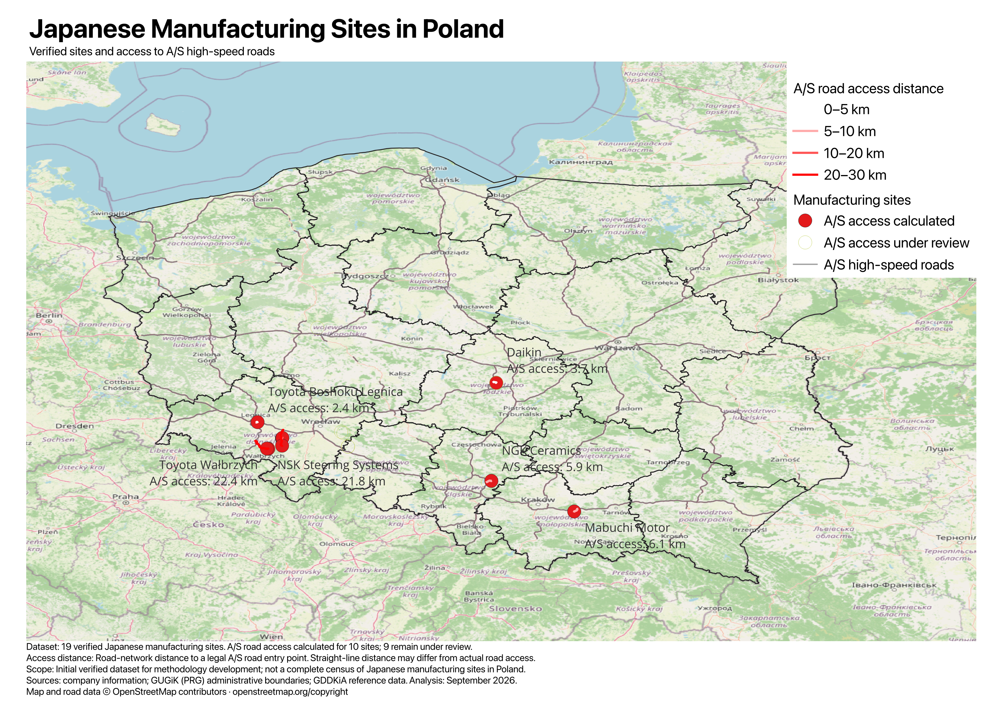

# Poland Location Intelligence

Location intelligence about manufacturing and business activity in Poland, with an initial focus on Japanese companies. The project connects business and location questions with Polish official, open and local information, GIS analysis, and clear analytical outputs.

## Japanese Manufacturing Sites in Poland

The first analysis asks: **Where are the currently verified Japanese manufacturing sites, and how accessible are they to Poland's A/S high-speed-road network?**

Map and road data: © [OpenStreetMap contributors](https://www.openstreetmap.org/copyright); OSM data is available under the Open Database License (ODbL). Other sources are described below.

[Download the PDF map](maps/japanese_manufacturing_sites_poland_overview_v0.1.pdf).

This v0.1 analysis uses an initial dataset of **19 verified geographical manufacturing sites**. It supports both location-intelligence outputs and methodology development; it is **not a complete census** of Japanese manufacturing sites in Poland.

## What the map shows

- Verified manufacturing-site locations.
- Poland's A-class motorways and S-class expressways.
- Calculated road-network access routes and distance classes.
- Sites whose A/S access results remain under review.

**A/S road access distance** means road-network distance from a manufacturing site to a legal entry point onto an A- or S-class high-speed road. In this version, measurement starts at the site's associated road-network origin and ends at the mainline entry; the connection from the recorded site point to that origin is excluded. Results depend on mapped access conditions and origin-access assumptions.

Straight-line proximity to a motorway or expressway does not necessarily equal actual legal road access, so this analysis uses road-network distance.

## Current observations

The 10 calculated access distances range from approximately **2.4 km to 26.8 km**, showing variation within this verified subset. Two calculated results are below 5 km, two are between 5 and 10 km, three between 10 and 20 km, and three between 20 and 30 km.

The other **9 sites remain under review** because the current routing and verification model cannot yet confidently determine a valid result. This does **not** imply poor road access. Neither these results nor the mapped distribution support conclusions about the complete population of Japanese manufacturers in Poland.

## Dataset scope

The current verified dataset contains 19 manufacturing sites, initially assembled primarily from candidate-company lists such as the Japanese business/chamber member list and reviewed using company or official information.

A site is a distinct geographical manufacturing location. One company may operate several sites; multiple buildings at one location do not automatically count as separate sites. Verification is based on project review, not certification by a public authority. Supporting source documentation remains incomplete for some records.

The dataset will expand as additional candidates are discovered and verified.

## Methodology

Candidate discovery, manufacturing-site verification and coordinate review establish the site locations. Road-network analysis then estimates access to a legal A/S entry, with calculated and unresolved results kept distinct. Calculated results remain subject to access assumptions and further quality review.

See the [methodology and limitations](methodology/methodology.md).

## Data sources

- **Company and official information:** identification and verification of manufacturing sites.
- **OpenStreetMap:** map/background data and road-network analysis, including the public A/S high-speed-road layer and road-access calculations; also address-based coordinate candidates.
- **GDDKiA reference layers via Geoportal:** official reference and visual validation of the A/S road network. These layers are not rendered in the public map and are not the geometry used for the public A/S road layer or routing calculations.
- **GUGiK / PRG, via Geoportal:** administrative boundaries from Państwowy Rejestr Granic (PRG), maintained by Główny Urząd Geodezji i Kartografii (GUGiK). PRG data were processed for GIS analysis.

Source dates and completeness vary. Analysis date: **September 2026**. No raw datasets are distributed in this publication.

## Status

| v0.1 coverage | Sites |
| --- | ---: |
| Verified manufacturing sites | 19 |
| A/S road-access results calculated | 10 |
| A/S access under review | 9 |

Distances are model-based passenger-car access estimates, not travel times or truck-routing assessments. Site-entry permissions and changing road conditions can affect practical access.

## Roadmap

- Expand the verified Japanese manufacturing-site dataset.
- Review and complete remaining A/S accessibility results.
- Add other relevant business and location dimensions.
- Eventually extend the framework to manufacturing sites associated with companies from other countries.

© 2026 Kenji Kumada. Original analysis, maps, and publication content are reserved unless otherwise noted. Third-party data remain subject to their respective terms and licenses.
